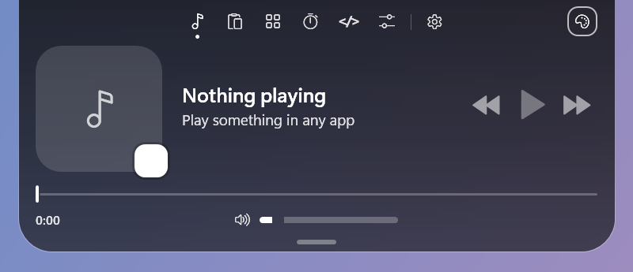
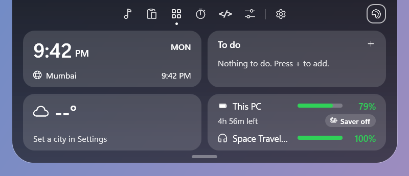
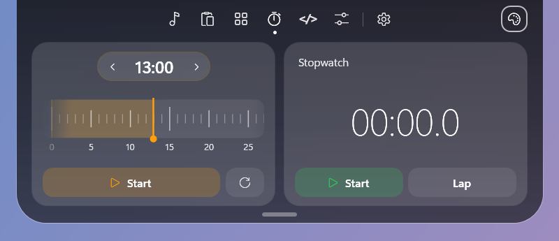
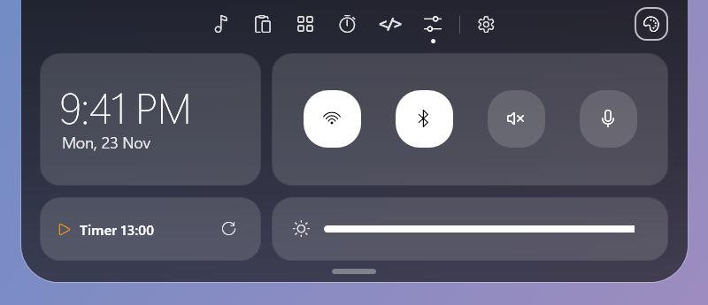
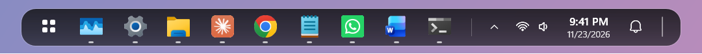

<h1 align="center">Lagoon</h1>

<p align="center">
  <b>A Dynamic-Island-style notch and a floating dock for Windows 11.</b><br>
  Event-driven, ~20 MB of RAM, no background polling.
</p>

<p align="center">
  
  
  
  
</p>

<p align="center">
  
  
  
  
  
</p>

Lagoon adds two things to the Windows desktop. A **notch** sits at the top of the screen: hover or
tap it to open a card with your music, clipboard history, widgets, timers and quick controls, and
it slides out little alerts and your notifications. A **floating dock** replaces the Windows
taskbar with a centred, auto-hiding bar for your apps, the system tray, quick settings and the clock.

Everything is driven by Windows events (WinEvent hooks, Core Audio callbacks, WLAN and power
notifications, WNF), so it costs almost nothing while you're not looking at it.

---

## Features

### The notch
- **Spring-animated pill** that grows into a card. It shrinks to a slim line over apps and hides
  completely in fullscreen video and games, but not when an app is just maximised.
- **Media:** album art, a wavy progress bar you can scrub, play/pause/skip and a volume slider, for
  any app that publishes media controls (Spotify, YouTube in a browser...). Equaliser bars in the
  pill while music plays.
- **Clipboard history:** text and images, pin items, one tap to copy again.
- **Widgets:** clock and a world clock, weather, a to-do list, and battery with time left or time
  to full, a battery saver switch, and your Bluetooth earbuds' battery level.
- **Timer and stopwatch:** a ruler-style picker you drag like a tape measure. The time counts down
  in the pill; when it ends an alarm sounds and the notch pops out (silently in fullscreen, with a
  catch-up alert afterwards).
- **Quick controls:** Wi-Fi, Bluetooth, mute, microphone, brightness.
- **Claude Code tab:** live status of your Claude Code sessions, via local hooks.
- **Notifications through the notch:** new Windows notifications slide out of the notch instead of
  Windows' own pop-ups (tap to open the app, swipe to dismiss, several queue up). Do not disturb
  included. Windows' banners are restored exactly when you turn it off or quit.
- **Privacy indicators:** a dot when the camera or microphone is in use, and a call timer during
  WhatsApp, Meet and other calls.
- **Smart pop-outs:**
  - copied a message with a one-time code: the code pops out, one tap copies just the digits
  - a download finishes: open it or show it in the folder
  - earbuds connected, with their battery level
  - charger plugged in or out (with "full in 1h 20m"), low battery, fully charged
  - Caps Lock and microphone mute from anywhere (Ctrl+Alt+M mutes the mic system-wide)
  - Wi-Fi connected or lost
- **Long-press the pill** for a quick peek at battery, time left, RAM and CPU.
- **Themes:** solid black or frosted glass.

### The dock
- **Replaces the taskbar:** the Windows taskbar is hidden while Lagoon runs and comes back exactly
  as it was when you quit (or if Lagoon ever crashes).
- **Apps:** pinned apps and open windows grouped per app, with crisp icons; right-click to pin,
  unpin and reorder; window previews on hover.
- **Auto-hides** when a window touches it; a home pill at the very bottom brings it back (works
  with touch).
- **Background apps:** the tray icons Windows hides behind its "^" arrow, with quick ways to open
  or close them.
- **Status icons that follow the system:** Wi-Fi bars by signal strength (or "no internet"), and a
  speaker icon that follows the volume level.
- **Control Center:** Wi-Fi and Bluetooth lists, audio output/input switching, brightness and
  volume sliders, battery saver, rotation lock, do not disturb and more.
- **Calendar and notification centre** under the clock and bell.
- **Show desktop** strip at the right end: tap to minimise everything, hover to peek at the desktop.
- **Start menu** opens centred and closes with a tap, including in tablet mode.
- The home pill adapts its colour to what's behind it.

### Built to be light
- ~20 MB of private memory, software rendering (no Direct3D device), no polling loops.
- A freeze guard restores the taskbar, saves a diagnostic snapshot and restarts Lagoon if its UI
  ever stops responding.
- Starts at sign-in through a scheduled task (faster than the Run key, so the old taskbar never
  flashes), and comes back by itself on unlock if it was ever closed.

---

## Install

Download the latest **LagoonSetup** from [Releases](../../releases), run it, done. It installs per
user (no admin needed). Windows SmartScreen may warn because the app isn't code-signed: click
**More info** → **Run anyway**.

Requires Windows 11 (or Windows 10 2004+), 64-bit.

## Build from source

```powershell
git clone <this repo>
cd Lagoon
dotnet build -c Release
```

Requires the .NET 10 SDK. Build output goes to `%LOCALAPPDATA%\LagoonBuild` (see
`Directory.Build.props`). See [docs/DEVELOPMENT.md](docs/DEVELOPMENT.md) for the self-contained
release build, the installer and the dev switches.

## How it works

| Area | Windows APIs |
|---|---|
| Notch visibility (apps, fullscreen) | `SetWinEventHook`, DWM frame bounds, `SHQueryUserNotificationState` |
| Media | `GlobalSystemMediaTransportControlsSessionManager` (WinRT) |
| Notifications | `UserNotificationListener` + the shell's WNF change signal |
| Volume, mute, devices | Core Audio (`IAudioEndpointVolumeCallback`, `IMMNotificationClient`, `IPolicyConfig`) |
| Wi-Fi | `WlanRegisterNotification`, `NetworkInformation` |
| Battery | `WM_POWERBROADCAST`, `RegisterPowerSettingNotification`, `Windows.Devices.Power` |
| Bluetooth battery | `cfgmgr32` device properties |
| Taskbar replacement | `Shell_TrayWnd` control, auto-hide, `EVENT_OBJECT_SHOW` hook |
| Desktop peek | DWM live preview |

The app is WPF on .NET 10 with layered, fixed-size windows that never resize while animating,
so redraws stay small and the UI thread is idle between events.

## Project layout

```
App.xaml.cs            start-up, single instance, crash and freeze handling
MainWindow*.cs         the notch: modes, alerts, notifications, timers, pop-outs
CardWindow.xaml        the card's tabs
DockWindow*.cs         the dock, its pill and auto-hide
DockPopup.xaml         Control Center, calendar, notifications, background apps
SettingsWindow.xaml    settings
Services/              one small class per system integration (audio, Wi-Fi, battery, taskbar...)
installer/             Inno Setup script
```

## License

[MIT](LICENSE)
